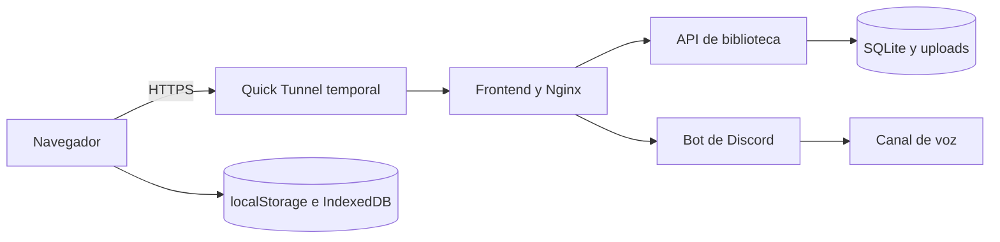

# Informe técnico: Bardo Politanense

## Función y estructura

Bardo es un reproductor flotante en React: álbumes, lista reordenable, enlaces y archivos de audio, controles de reproducción, repetición, volumen y captura de pestaña. La extensión opcional para Brave, Opera GX y Opera puede enviar controles multimedia a una pestaña externa cuando esta los expone. El bot de Discord recibe audio capturado por el navegador y lo reproduce en un canal de voz.



`compose.yaml` construye tres imágenes: frontend con pnpm en una etapa y Nginx como etapa final; bot con dependencias de Node y FFmpeg en su etapa final; biblioteca con Node sin dependencias externas y usuario sin privilegios. `compose.quick.yaml` agrega Cloudflare en una imagen propia de dos etapas: copia el ejecutable oficial a Alpine y publica el hostname actual en un volumen compartido de solo lectura para la biblioteca. Los puertos frontend y API solo escuchan en loopback. El túnel hace una conexión saliente, por lo que no hay que publicar la IP doméstica ni abrir un puerto del router.

## Persistencia y sincronización

La ruta configurable `LIBRARY_DATA_DIR` apunta en este equipo a `C:\Users\juaul\Documents\Codex\bardo-data`, fuera del proyecto y de OneDrive. `library.sqlite` es la base principal: tablas de álbumes, canciones, pertenencia a varios álbumes y revisión. Las mutaciones se serializan y se confirman en transacciones SQLite con WAL. `uploads/` guarda los archivos de audio; `library.json` se importó una vez y permanece como respaldo. Los clientes consultan la revisión cada cuatro segundos. `localStorage` acelera el primer render e IndexedDB guarda archivos locales pendientes; ninguna copia reemplaza al servidor para compartir música.

La API ofrece CRUD autenticado de álbumes y canciones en `/api/library/albums` y `/api/library/tracks`, con rutas `/:id` para lectura, edición y eliminación. `/api/library/sync` sigue aplicando cambios y ordenaciones de la interfaz en una operación. [library/README.md](library/README.md) documenta métodos, cuerpos JSON y carga de archivos.

El frontend local se publica únicamente en `http://localhost:8088/`. El navegador mantiene una copia de carga rápida, mientras SQLite y `uploads/` conservan la biblioteca compartida. Se retiraron la publicación y los atajos del antiguo puerto 5173 sin borrar datos de canciones ni álbumes.

## Acceso directo por invitación

El propietario posee una clave de 256 bits fuera del proyecto. **Generar invitación** crea una clave distinta para el amigo y la guarda en el volumen persistente. El enlace usa `#invite=...`: el fragmento no viaja en la petición HTTP. El frontend toma esa clave al abrir la URL, la guarda en el navegador, limpia la barra de direcciones y obtiene una cookie HTTP de sesión de manera automática. No se pide correo, PIN ni contraseña. La API exige acceso para leer catálogo, reproducir archivos y editar; solo el propietario puede generar la invitación. El amigo puede agregar, modificar y quitar música.

El propietario local usa un endpoint auxiliar ligado únicamente a `127.0.0.1:3003`. Solo acepta los orígenes locales de Bardo y entrega la clave al propio frontend para activar la sesión e importar las canciones guardadas en ese navegador. Nginx y Cloudflare no publican ese endpoint; la petición pública a `/api/owner` devuelve 404.

El enlace es una credencial transferible: **no puede garantizarse que solo lo use una persona si se reenvía**. El hostname temporal cambia al reiniciar el túnel; la API lee el hostname actual y descarta el anterior automáticamente. El frontend estático se puede abrir con la dirección central, pero sin invitación no entrega la biblioteca. Cloudflare Quick Tunnels no necesita cuenta ni dominio y no ofrece disponibilidad garantizada. No se habilita la verificación por correo de Cloudflare porque el acceso debe ocurrir al abrir el enlace. Para una URL fija futura hará falta un dominio. [Referencia de Cloudflare](https://developers.cloudflare.com/tunnel/get-started/quick-tunnels/).

## Discord y barra de reproducción

`/conectar` une al bot al canal de voz y entrega un código temporal para emparejar una sesión del reproductor. El navegador envía audio WebM Opus por WebSocket; FFmpeg lo convierte a paquetes Opus de 20 ms. Se conserva el búfer inicial de **1200 ms** confirmado como fluido. La barra de progreso se muestra con una demora aproximada y espera el estado de reproducción que informa el bot. Esta presentación visual no retrasa el audio ni mide la latencia final de cada oyente en Discord.

La captura `getDisplayMedia` requiere un origen seguro. El enlace HTTPS de Cloudflare lo proporciona, y el permiso de elegir pestaña/audio es el diálogo normal del navegador. La extensión no es necesaria para el túnel ni para reproducir archivos guardados; sirve para controlar multimedia de otra pestaña. Se entrega en `Bardo-Extension-Instalador/Instalar-Bardo-Extension.exe`. El instalador muestra Brave, Opera GX y Opera en ese orden; crea un perfil propio y un acceso directo que carga la extensión al iniciar el navegador, sin Modo desarrollador. Reconoce `localhost` y `*.trycloudflare.com`. La carga automática se probó en los tres navegadores con perfiles temporales.

Las 39 canciones migradas actualmente son enlaces de YouTube. Al migrar a SQLite se había omitido `videoId`; el frontend generaba un iframe vacío. El backend ya reconstruye y persiste los 39 ID desde sus URL, y el frontend puede derivarlos al reproducir. El iframe conserva un área de 256 × 200 píxeles para la API de YouTube y se oculta visualmente con `scale(0)`; Play antes de que se cargue queda pendiente. Después de 15 segundos sin respuesta, aparece una opción para mostrar el video y reintentar, además del enlace de origen. La API de YouTube ya no permite forzar una calidad de video concreta; la plataforma la selecciona automáticamente. Los enlaces siguen dependiendo de YouTube; para reproducción independiente del servicio, hay que subir archivos de audio autorizados a `uploads/`.

## Caché, errores y operación

Vite genera JS y CSS con hash. Nginx los comprime con gzip, les asigna caché `immutable` de un año y revalida HTML. React descarga los adaptadores de YouTube y Spotify, el modal y la biblioteca completa cuando se necesitan. `localStorage` muestra la biblioteca al inicio y agrupa las escrituras durante 250 ms; SQLite sigue siendo la fuente compartida. La biblioteca devuelve `no-store` para metadatos; el audio admite `Range`. Las rutas inexistentes muestran una página 404; los errores 500–504 tienen página propia. La API entrega JSON con códigos 400, 401, 403 y 413 según el caso. El reproductor ahora ofrece una vista maximizada responsiva y una biblioteca compacta propia al minimizar.

Comandos principales, desde la carpeta raíz:

```powershell
docker compose config --quiet
docker compose build
docker compose up -d
./tools/Start-QuickTunnel.ps1
docker compose -f compose.yaml -f compose.quick.yaml ps
./tools/Stop-QuickTunnel.ps1
docker compose down
```

Para respaldar, detén los contenedores y copia `bardo-data` completo, incluidos posibles archivos `library.sqlite-wal` y `library.sqlite-shm`. Guarda aparte el token del bot y la clave del propietario. `.env`, secretos, atajos privados y datos están excluidos por `.gitignore`.

## Verificación

La prueba aislada de la API comprueba migración JSON→SQLite, persistencia tras reinicio, CRUD de álbumes y canciones, recuperación de ID de YouTube, archivos con `Range`, dos roles y prohibición de acceso anónimo. Las imágenes frontend y biblioteca se construyeron con Docker Compose. El enlace Quick Tunnel respondió por HTTPS; una lectura anónima recibió 401, el propietario y amigo recibieron sus roles respectivos, y el amigo recibió 403 al intentar crear otra invitación. Una sesión nueva de amigo obtuvo 200 y leyó los mismos datos con `GET /api/library/albums` y `GET /api/library/tracks`; sin sesión, la API respondió 401. En Edge se reprodujo el fallo de pegar `#invite` en una pestaña ya abierta: la navegación cambiaba solo el fragmento y React no releía la invitación. Tras agregar el manejador de `hashchange`, una prueba desde una pestaña pública sin sesión mostró los álbumes y canciones al abrir el enlace, sin recarga manual. El túnel temporal puede cambiar o cesar sin aviso.

Tras corregir la dirección obsoleta de `.env`, la prueba posterior confirmó que `/api/library/info` refleja el nuevo hostname de Cloudflare. Una invitación generada por `/api/library/invite` coincidió con ese hostname; usando el enlace HTTPS y una sesión de amigo se leyeron **11 álbumes y 66 canciones**. El botón «Generar invitación» quedó habilitado en la interfaz local. El archivo de estado del túnel se limpia al detener el contenedor, por lo que una URL anterior no se reutiliza durante el próximo inicio.

En la optimización posterior, la imagen frontend se compiló con `pnpm build` dentro de Docker y `oxlint` terminó sin errores (tres advertencias previas en otros módulos). Se comprobó que `index.html` responde 200 con `Cache-Control: no-cache` y que el CSS versionado responde con `Cache-Control: public, max-age=31536000, immutable` y `Vary: Accept-Encoding`. En Brave, una canción real de YouTube cargó su duración de 4:56 con el iframe visualmente oculto, avanzó al pulsar Play y se detuvo al pulsar Pausa. La vista maximizada y la lista compacta se verificaron visualmente en el navegador.
